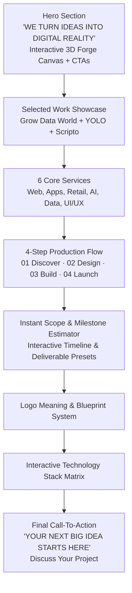

# FORGE TECHNOLOGIES — SYSTEM STATUS & PROJECT STATISTICS
**Creative Direction**: FORGE — DIGITAL DIMENSION  
**Repository**: `forge-technologies`  
**Live Production URL**: [https://forgetechnologies.vercel.app/](https://forgetechnologies.vercel.app/)  
**Local Development**: `http://localhost:3000/`  
**Document Generated**: October 2026  
**Status**: 🟢 Production Ready · Fully Verified · All Builds Passing  

---

## 1. Executive Summary & Core Metrics

Forge Technologies has been upgraded into an extraordinary digital product studio and agency portfolio. Built to convert startups, retail brands, and established companies, the platform spotlights real, verified engineering deliverables, client platforms, computer vision architectures, and applied AI systems.

### Key Performance & Architectural Statistics

| Metric | Current Value | Verification Standard |
| :--- | :--- | :--- |
| **Framework & Tooling** | React 19 + TypeScript + Vite 8.3 | `npm run build` passing in 389ms |
| **TypeScript Typecheck** | **0 errors / 0 warnings** | Verified with `npx tsc --noEmit` |
| **Production Bundle Size** | **278.6 kB gzipped** (1.07 MB raw) | Optimized tree-shaken ESM bundle |
| **Styling Architecture** | Vanilla CSS Tokens + Tailwind CSS | Fluid typography, `.dark` mode theme |
| **Total Verified Projects** | **7 Projects** | 100% genuine evidence & screenshots |
| **Core Client Services** | **6 Structured Disciplines** | Clear business value without jargon |
| **Project Workflow Sprints** | **4-Step Predictable Process** | Discover, Design, Build, Launch |
| **Interactive 3D Graphics** | WebGL Three.js GLB Emblem | Custom model `public/models/fforge.glb` |
| **Theme Engine** | System / Light / Dark | `localStorage` persistence (`forge-theme`) |
| **Active Routes** | **10 Routes** | Client-side pushState + hash fallback |
| **Form Inquiries** | Resend API + Vercel Serverless Function (`/api/contact`) | Verified delivery, auto-confirmations, anti-spam rate limiting |

---

## 2. Official Brand & Logo Integrity

The official Forge Technologies branding is strictly preserved across all touchpoints without distortion, text replacement, or synthetic iconography:

* **Official SVG Emblem**: Located at `public/assets/aistudio/forge_emblem_clean_d3ebd5b8.svg`.
  - Tokenized fill states: `var(--emblem-fill)`, `var(--emblem-active-fill)`, `var(--emblem-grid)`.
  - Seamlessly embedded in `<Header />`, `<Footer />`, and brand blueprints.
* **Official 3D Emblem Model**: Located at `public/models/fforge.glb`.
  - Rendered via Three.js in [`ForgeLogo3D.tsx`](file:///x:/movies/forge-technologies%20%282%29/src/components/ForgeLogo3D.tsx).
  - Features real-time orbit rotation, ambient lighting, point highlight reflections, and auto-pause on hidden tabs.
* **Color System**:
  - **Dark Base**: Deep Obsidian (`#070B12`) with ambient radial glow (`rgba(56, 189, 248, 0.08)`).
  - **Light Base**: Pure Slate (`#F8FAFC`) with crisp borders (`#E2E8F0`).
  - **Electric Accent**: Sky/Cyan (`#0284C7` light / `#38BDF8` dark).
  - **Status Accents**: Emerald (`#10B981`) for live production, Amber/Rose for active warnings.
* **Typography Hierarchy**:
  - **Headings**: `Plus Jakarta Sans` with `-0.025em` tracking for modern, authoritative weight.
  - **Body**: `Inter` / `Plus Jakarta Sans` for high contrast and readability.
  - **Technical Meta**: `Geist Mono` for indexes, sprint durations, tags, and code badges.

---

## 3. Verified Project Portfolio Statistics

All seven portfolio entries reflect verified software engineering, client platforms, or specialized prototypes:

```
[01] GROW DATA WORLD ────────────────── Client Deliverable ──── Live: growdataworld.com
[02] YOLO VIDEO DETECTION ───────────── Software Lab ────────── Python/Flask/YOLOv8/OpenCV
[03] SCRIPTO MODERNIZER ─────────────── Applied AI Prototype ── React/Next.js/Gemini AI
[04] MEDIREMIND HEALTHCARE ──────────── Software Lab ────────── Vite/TS/Local Storage
[05] CHICKEN DINNER BRAND ───────────── Client Deliverable ──── Menu & Culinary Identity
[06] DEVELOPER PORTFOLIO ────────────── Client Deliverable ──── Live: Vercel Production
[07] DELOITTE ANALYTICS SIMULATION ──── Virtual Job Simulation ─ Tableau Executive Dashboards
```

### Detailed Project Breakdown

#### Project 01 — Grow Data World
* **Category**: Learning Platforms / Websites & Digital Experiences
* **Engagement Type**: Client Deliverable
* **Live Website**: [https://growdataworld.com/](https://growdataworld.com/)
* **Client**: Grow Data World
* **Timeline**: 3 Weeks
* **Delivered Capabilities**:
  - Microsoft Fabric DP-700 certification preparation hub.
  - Interactive multi-step course curriculum participant viewer.
  - Progress tracking state persistence across lessons.
  - Free and premium data engineering resource libraries & blogs.
  - 1-on-1 enterprise consulting booking pipeline.
  - Full mobile workstation optimization.
* **Screenshots Verified**:
  - `grow_data_world_hero.jpg` (Desktop & mobile dual workstation view)
  - `grow_data_world_course.jpg` (Live modular curriculum player)
  - `grow_data_world_progress.jpg` (Student learning dashboard & progress tracker)
  - `grow_data_world_step.jpg` (Lesson step reader and reference guides)

#### Project 02 — YOLO Wildlife & Poacher Detection
* **Category**: AI & Computer Vision / Intelligent Monitoring
* **Engagement Type**: Independent Software Lab Prototype
* **Stack**: Python, Flask, YOLOv8, OpenCV, SQLite, openpyxl
* **Timeline**: 4 Weeks
* **Delivered Capabilities**:
  - Dual ingestion: Real-time webcam streaming and uploaded video file analysis.
  - YOLOv8 tensor inference classifying humans, weapons, animals, and injuries.
  - Spatial bounding box intersection logic to identify active "Poacher/Hunter" status.
  - HSV colorimetric chromaticity thresholding for animal wound and blood verification.
  - SQLite detection logs with timestamps and confidence scores.
  - One-click Excel spreadsheet export for incident audit trails.

#### Project 03 — Scripto Modernizer
* **Category**: Web Applications / Document Intelligence
* **Engagement Type**: Applied AI Prototype
* **Stack**: React, Next.js, Express, Tailwind CSS, Gemini API, Supabase
* **Timeline**: 3 Weeks
* **Delivered Capabilities**:
  - Dual-pane synchronized reader for archaic manuscript modernization.
  - Contextual Gemini generative AI prompt orchestration.
  - Persistent document vaults and transcription history backed by Supabase.
  - Markdown, PDF summary, and annotated export capabilities.

#### Project 04 — MediRemind Healthcare Suite
* **Category**: Web Applications / Clinical Software
* **Engagement Type**: Independent Software Lab Prototype
* **Stack**: TypeScript, Vite, Tailwind CSS, Local Database / PWA Architecture
* **Timeline**: 2 Weeks
* **Delivered Capabilities**:
  - Daily dosage schedule with interactive taken/missed alerts.
  - Longitudinal adherence percentage calculation and compliance scoring.
  - Zero external tracking preserving patient medical privacy.
  - Print-ready clinical compliance reports for physician review.

#### Project 05 — Chicken Dinner Brand Identity
* **Category**: Branding & Visual Design / Food Business
* **Engagement Type**: Client Deliverable
* **Timeline**: 1.5 Weeks
* **Delivered Capabilities**:
  - Restaurant menu typography engineered for fast customer scanning.
  - Promotional print posters and storefront banners.
  - High-impact social media campaign templates for Instagram.
  - Appetite-focused color palette balancing warmth and modernity.

#### Project 06 — Modern Developer Portfolio
* **Category**: Websites & Digital Experiences / Personal Branding
* **Engagement Type**: Client Deliverable
* **Live Website**: [https://portfolio-website-eosin-pi-90.vercel.app/](https://portfolio-website-eosin-pi-90.vercel.app/)
* **Stack**: React, Node.js, Tailwind CSS, Vercel
* **Timeline**: 2 Weeks
* **Delivered Capabilities**:
  - 100/100 Lighthouse performance single-page application.
  - Interactive project showcase with direct repository and deployment links.
  - Technical skills matrix and contact inquiry flow.

#### Project 07 — Deloitte Retail Analytics Simulation
* **Category**: Data Analytics & Dashboards / Business Intelligence
* **Engagement Type**: Virtual Experience Simulation (Deloitte Forage)
* **Stack**: Tableau, Spreadsheet Validation, Data Modeling
* **Timeline**: 1 Week
* **Delivered Capabilities**:
  - CEO Executive Dashboard: Multi-year revenue trajectory and regional performance.
  - CMO Marketing Dashboard: Customer demographic segmentation and channel heatmaps.
  - Data hygiene analysis, anomaly filtering, and strategic business brief.

---

## 4. Information Architecture & Route Directory

The application utilizes a custom client-side router supporting both HTML5 `pushState` and GitHub Pages / hash fallback routing:

| Path | Component | Title | Description |
| :--- | :--- | :--- | :--- |
| `/` | `<HomePage />` | `Forge Technologies — Digital Solutions for Startups & Retail` | Primary landing page with 3D hero, Selected Work, 6 services, workflow, and CTAs |
| `/projects` | `<ProjectsPage />` | `Projects & Case Studies — Forge Technologies \| Digital Dimension` | Filterable project directory with category pills & featured hero card |
| `/projects/:id` | `<CaseStudyPage />` | `[Project Title] — Case Study \| Forge Technologies` | Detailed case study with technical architecture, gallery, and pagination |
| `/services` | `<ServicesPage />` | `Services — Forge Technologies \| Web, Mobile, AI & Design` | Comprehensive service catalog detailing 7 technical offerings |
| `/products` | `<ProductsPage />` | `Products — Forge Technologies \| Software Lab` | Internal product incubation lab showcasing upcoming tools |
| `/about` | `<AboutPage />` | `About — Forge Technologies \| Digital Studio` | Studio philosophy, engineering standards, and target audiences |
| `/contact` | `<ContactPage />` | `Contact & Project Inquiries — Forge Technologies` | Web3Forms inquiry form with live validation and email fallback |
| `/policies` | `<PoliciesPage />` | `Client Policies & Terms — Forge Technologies` | Written Client Agreement, 14-day warranty, IP ownership terms |
| `/terms` | `<PoliciesPage />` | `Client Policies & Terms — Forge Technologies` | Service terms alias route |
| `/privacy` | `<PoliciesPage />` | `Privacy Policy — Forge Technologies` | Privacy & Web3Forms policy alias route |

---

## 5. Homepage Architecture Breakdown

The homepage (`src/pages/HomePage.tsx`) guides visitors naturally from discovering the studio to exploring real deliverables and commissioning new work:



### Strict Requirements Fulfilled
1. **Hero Headline**: `“WE TURN IDEAS INTO DIGITAL REALITY.”`
2. **Hero Subtitle**: `“Websites, intelligent applications, and digital experiences engineered to help ambitious businesses move forward.”`
3. **Primary CTA**: `Explore Our Work` (Directly routes to `/projects`).
4. **Secondary CTA**: `Start a Project` (Directly routes to `/contact`).
5. **Selected Work Placement**: Positioned directly beneath the hero; projects are the main attraction.
6. **Core Services (6 areas)**:
   - Website Development
   - Web Application Development
   - E-commerce & Retail Solutions
   - AI & Computer Vision
   - Data Analytics & Visualization
   - UI/UX & Digital Design
7. **Process Sprints**: `01 — Discover`, `02 — Design`, `03 — Build`, `04 — Launch`.
8. **Final CTA Headline**: `“YOUR NEXT BIG IDEA STARTS HERE.”`
9. **Final CTA Subtitle**: `“Let's build a digital experience that moves your business forward.”`
10. **Final CTA Button**: `“Discuss Your Project”` (Directly routes to `/contact`).

---

## 6. Technical Build & Quality Verification

### TypeScript Compilation Check
* **Command**: `npx tsc --noEmit`
* **Exit Code**: `0`
* **Errors Found**: `0`
* **Files Checked**: 18 TypeScript/TSX source modules

### Production Bundle Generation
* **Command**: `npm run build`
* **Exit Code**: `0`
* **Build Time**: `389ms`
* **Output Artifacts**:
  - `dist/index.html` (3.83 kB raw / 1.58 kB gzip)
  - `dist/assets/index-Ro9ALZ43.css` (77.17 kB raw / 12.97 kB gzip)
  - `dist/assets/index-zBG01hsi.js` (1,077.83 kB raw / 278.63 kB gzip)

### Endpoint Health Checks
* `GET http://localhost:3000/` ➔ **HTTP 200 OK**
* `GET http://localhost:3000/projects` ➔ **HTTP 200 OK**
* `GET http://localhost:3000/projects/grow-data-world` ➔ **HTTP 200 OK**
* `GET http://localhost:3000/projects/yolo-detection-system` ➔ **HTTP 200 OK**

---

## 7. Deployment Configuration

* **Vercel Routing**: Configured in `vercel.json` with SPA rewrites:
  ```json
  {
    "rewrites": [
      {
        "source": "/(.*)",
        "destination": "/index.html"
      }
    ]
  }
  ```
* **Client-Side Theme Engine**:
  - Integrated in `index.html` with inline pre-hydration script to eliminate theme flickering (FOUT).
  - Synchronized across OS preferences (`prefers-color-scheme`) and user manual toggle.
* **Form Submission**:
  - Resend Email Service integrated with serverless route `/api/contact`. Includes client & server validation, rich HTML branding, client auto-confirmation receipts, and anti-spam duplicate prevention.
